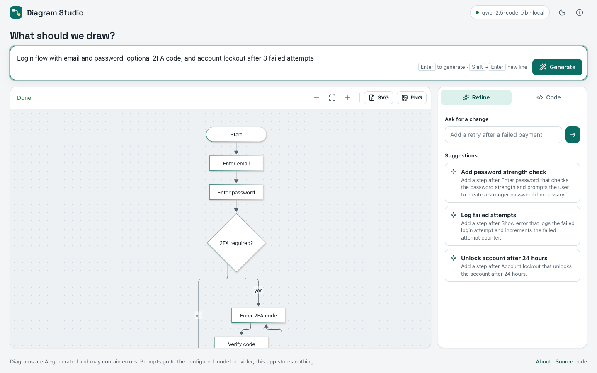
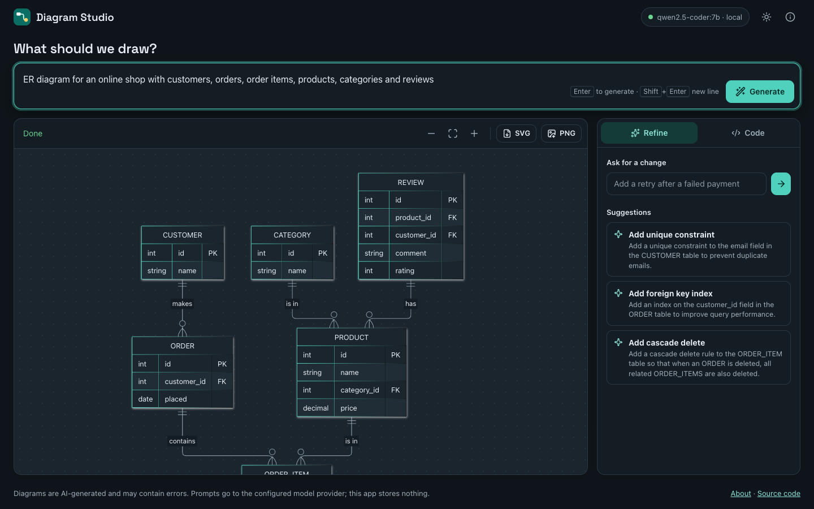
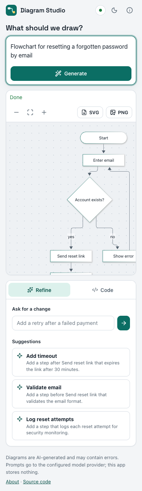

# Diagram Studio

Describe a process, system or data model in plain English and get an editable [Mermaid](https://mermaid.js.org) diagram.
Runs against a local model through [Ollama](https://ollama.com) by default, or any OpenAI-compatible API. Free, no
accounts, no usage limits beyond the ones you configure.



| Dark mode | Mobile |
|---|---|
|  |  |

> An independent open-source project, not affiliated with or endorsed by any company or commercial product. Diagram
> output is AI-generated and may contain errors.

## Features

- **Prompt to diagram**: flowcharts, sequence diagrams, ER diagrams and architecture diagrams.
- **Live streaming render**: the diagram draws as the model writes it, and the last valid render stays on screen while
  partial code is still incomplete.
- **Clarifying questions only when needed**: very short, vague prompts get up to three quick questions; detailed
  prompts go straight to drawing.
- **Automatic syntax repair**: code is cleaned deterministically (fences, stray prose, unquoted labels, unclosed
  shapes, reserved IDs), validated with Mermaid's parser, and sent back to the model with the parser error up to two
  times if it still fails.
- **Refine in plain English**: "Ask for a change" edits the diagram, and three suggested edits appear as one-click chips.
- **Editable source**: change the Mermaid code directly and the canvas re-renders; "Fix with AI" repairs broken code.
- **Export**: SVG and PNG (2x, white background).
- **Light and dark themes**, keyboard navigation, screen-reader labels, and a layout that works down to phone width.
- **Self-contained front end**: Mermaid, icons and fonts are served from your own server; the page makes no
  third-party requests.

## Quickstart (local, with Ollama)

Requires Node.js 20.12 or newer and [Ollama](https://ollama.com/download).

```bash
ollama pull qwen2.5-coder:7b       # about 4.7 GB; any instruction-tuned model works
git clone https://github.com/Navneet14-cmd/diagram-studio.git
cd diagram-studio
npm install
cp .env.example .env
npm start                          # http://localhost:8787
```

The header shows a green dot when the model is reachable. If it's red, a banner tells you the exact fix.

## Using an OpenAI-compatible API

Any hosted or self-hosted server that implements the OpenAI-compatible `POST /chat/completions` API works. In `.env`:

```bash
PROVIDER=openai
BASE_URL=https://api.openai.com/v1   # include the /v1 part
MODEL=gpt-4o-mini
API_KEY=your-key-here                # stays on the server, never sent to the browser
```

Larger models produce noticeably better diagrams than a 7B local model, and need fewer repairs.

## Configuration

All settings are environment variables (or lines in `.env`).

| Variable | Default | Description |
|---|---|---|
| `PROVIDER` | `ollama` | `ollama` or `openai` (any OpenAI-compatible API) |
| `BASE_URL` | `http://localhost:11434` (ollama) / `https://api.openai.com/v1` (openai) | Provider URL. For `openai`, include `/v1` |
| `MODEL` | `qwen2.5-coder:7b` / `gpt-4o-mini` | Model name |
| `API_KEY` | empty | Server-side key for hosted providers |
| `HOST` | `127.0.0.1` | Interface to listen on. Use `0.0.0.0` in containers |
| `PORT` | `8787` | HTTP port |
| `RATE_LIMIT_MAX` | `30` | AI requests allowed per IP per window. `0` disables |
| `RATE_LIMIT_WINDOW_MS` | `60000` | Rate-limit window |
| `TRUST_PROXY` | `false` | Use `X-Forwarded-For` for the client IP. Enable only behind a proxy you control |
| `MAX_PROMPT_CHARS` | `2000` | Longest accepted prompt or change request |
| `MAX_CODE_CHARS` | `12000` | Longest accepted diagram source |
| `MAX_BODY_KB` | `32` | Request body size limit |
| `MAX_TOKENS` | `1500` | Cap on generated tokens per call (256 to 4000) |
| `LLM_TIMEOUT_MS` | `120000` | Abort a model call after this long |
| `LOG_PROMPTS` | `false` | Log prompt text. Off by default: logs contain only method, path, status and timing |
| `ALLOW_USER_KEYS` | `false` | With `PROVIDER=openai`, let visitors paste their own API key (see below) |

### Bring your own key (optional)

With `ALLOW_USER_KEYS=true` and `PROVIDER=openai`, a key button appears in the header. A visitor's key is held only in
their browser tab's memory, sent with each request in an `x-user-api-key` header, used for that request only, and never
stored or logged by the server. Reloading the tab forgets it. Visitors cannot change `BASE_URL`, so keys only ever go to
the provider you configured.

## Running tests

```bash
npm test            # unit and API tests with a fake model: no network, no browser
npm run e2e         # real model + headless Chrome: 9 scenarios, screenshots in docs/screenshots/
npm run licenses    # dependency license check, regenerates THIRD_PARTY_LICENSES.md
```

`npm run e2e` needs Google Chrome and a reachable model. It covers generation, typed edits, suggestion chips, the
repair loop (by corrupting model output in flight), the failure state, SVG/PNG export, light and dark themes, and
390 px and 1440 px viewports.

## Deploying

### Docker

```bash
docker build -t diagram-studio .
docker run -p 8787:8787 --env-file .env -e HOST=0.0.0.0 diagram-studio
```

The image runs as a non-root user, contains no npm tooling at runtime, and has a health check on `/healthz`. To reach
Ollama on the host from Docker Desktop, use `BASE_URL=http://host.docker.internal:11434`.

### Render

`render.yaml` is a Render Blueprint. Push the repo to GitHub, choose **New > Blueprint** in Render, select the repo,
and set `API_KEY` in the dashboard when prompted. It deploys the Docker image with `PROVIDER=openai`.

Ollama can't run on free hosting tiers (it needs several GB of RAM, ideally a GPU). For a hosted instance, use a hosted
OpenAI-compatible API.

## Security notes

- **Don't expose an unprotected instance publicly with your own paid key.** The app has no login: anyone who can reach
  it can spend your model quota. Keep rate limiting on, set a spending limit with your provider, and put the app behind
  your own authentication (for example a reverse proxy) if needed.
- The server sends a strict Content-Security-Policy (scripts from the same origin only), `X-Content-Type-Options`,
  `Referrer-Policy: no-referrer`, `X-Frame-Options: DENY` and a restrictive `Permissions-Policy`.
- Mermaid runs with `securityLevel: "strict"`, and every rendered SVG is also passed through DOMPurify.
- Request bodies, prompts and diagram code have size limits. Model calls have a timeout and a token cap.
- Error responses never include stack traces or provider internals.
- Report vulnerabilities as described in [SECURITY.md](SECURITY.md).

## Troubleshooting

| Problem | Fix |
|---|---|
| "Ollama is not reachable" | Start it: `ollama serve` (or open the Ollama app). Check `BASE_URL` |
| "Model … is not pulled" | `ollama pull qwen2.5-coder:7b` (or whatever `MODEL` is set to) |
| `Port 8787 is already in use` | Set another `PORT` in `.env`, or find the other process with `lsof -i :8787` |
| Diagrams often need repair | Small local models make more syntax slips; try a larger model or a hosted API |
| "Too many requests" | You hit `RATE_LIMIT_MAX`; wait a minute or raise the limit |
| Works locally but not in Docker | Set `HOST=0.0.0.0`, and use `host.docker.internal` instead of `localhost` for Ollama |

## Project layout

```
server/    HTTP server, provider client, prompts, JSON normalisation, rate limiter, config
shared/    Mermaid sanitizer and repair loop (used by both server and browser)
public/    The web app (HTML, CSS, JS, logo)
test/      node:test suites
scripts/   e2e.mjs (Playwright screenshots), licenses.mjs (license check)
```

## License

[MIT](LICENSE). Third-party components and their licenses are listed in
[THIRD_PARTY_LICENSES.md](THIRD_PARTY_LICENSES.md).
